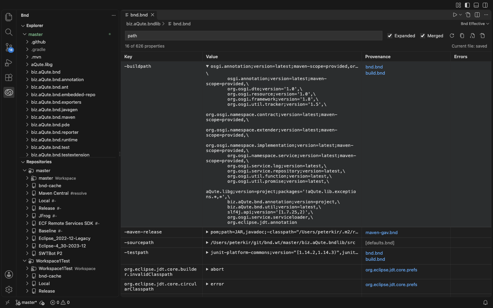

# Getting Started with Bnd and Bndrun Support

Welcome! This walkthrough explains the main capabilities of the **Bnd and Bndrun Support** extension.

## What This Extension Provides

| Capability | Description |
|---|---|
| Syntax highlighting | Full TextMate grammar for `.bnd` and `.bndrun` files |
| IntelliSense completions | 153 instructions, 138 macros, 48 OSGi headers |
| Hover documentation | Inline docs and examples from the official bnd reference |
| Diagnostics and quick fixes | Property conflicts, invalid `Bundle-Activator`, baseline version mismatches (Java server) |
| Effective properties | Read-only table of evaluated and merged properties with provenance |
| Run and Debug | `.bndrun` and project launches through the Java debugger |
| bnd views | Explorer, Repositories (with Advanced Search), Resolution panel, JAR Viewer |
| Workspace wizards | Create workspaces and add fragments from templates, import existing workspaces |
| Integrated CLI commands | 19 `bnd` CLI commands available from the Command Palette |
| Language server modes | Java, Node, or socket-based startup with fallback handling |
| CLI Reference panel | Searchable view of all 77 bnd CLI sub-commands |



## Quick Check

Open any `.bnd` or `.bndrun` file and verify that syntax highlighting is active — keywords like `-buildpath:` should appear in colour.

If no file is available yet, create `bnd.bnd` with the content below, or open an empty folder and use the bnd Explorer's **Create New Workspace From Template** action (see the *Create a Workspace* step):

```properties
Bundle-SymbolicName: com.example.hello
Bundle-Version: 1.0.0
-buildpath: osgi.core;version='[7,8)'
Export-Package: com.example.api;version='1.0.0'
```
