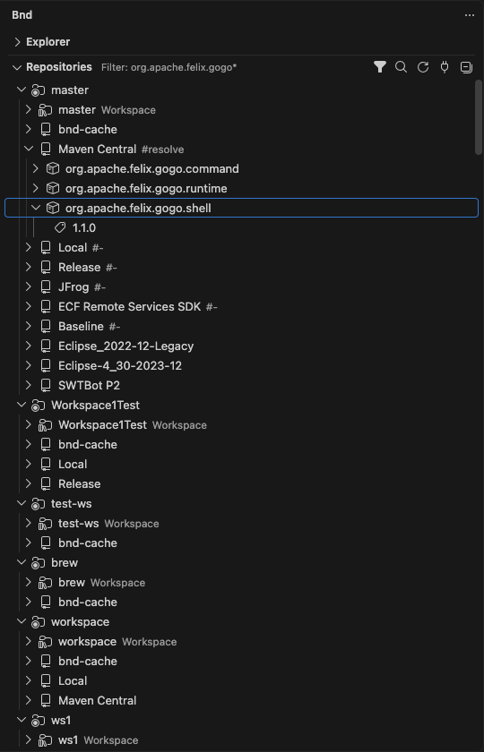
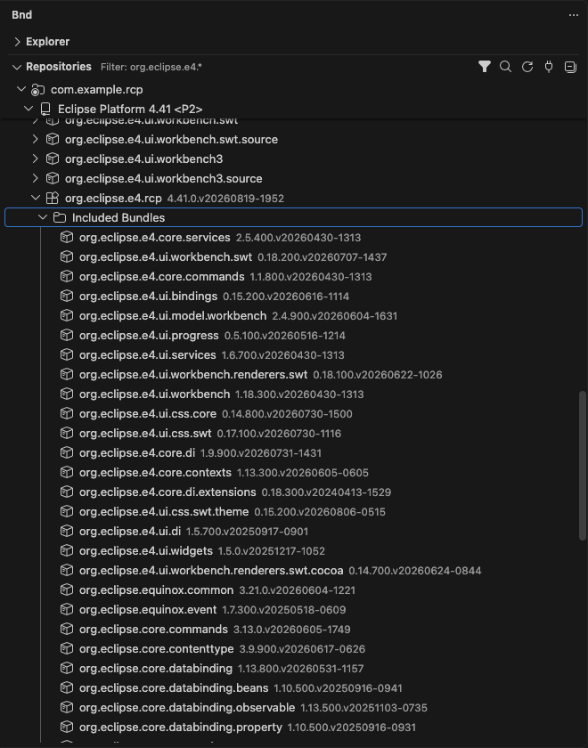
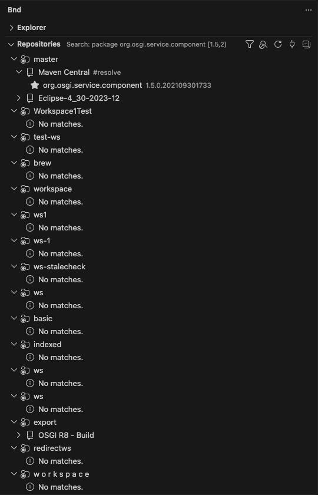
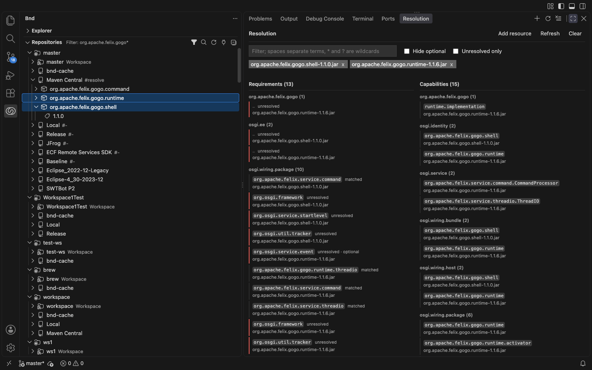
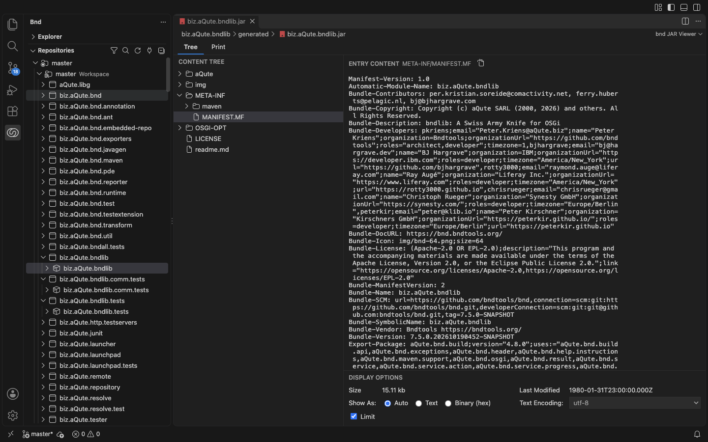

# Browse Repositories

Select the **bnd** icon in the Activity Bar to open the **Repositories** view. It works like the bndtools Repositories view in Eclipse.

| Filtered Maven repository | P2 feature with included bundles |
|---|---|
|  |  |

## Requirements

- A trusted workspace.
- `bnd.server.mode` set to `java` (or `socket` with a server that supports `bnd.repositories.list`). The Node fallback server cannot list repositories.
- A bnd workspace: a folder that contains `cnf/build.bnd`. Each bnd workspace in the opened folders appears as its own root.

## Browsing

- The **Workspace** repository lists projects and the bundles they build.
- Repository plugins list bundles, then versions (newest first). P2 and OSGi indexed repositories also list Eclipse features with their included features, included bundles, and requirements. Feature hierarchy comes from index metadata; no feature JAR download is needed. Member tooltips include the original requirement filter and optional status.
- Hover a repository to see its location and status. Repositories reporting a problem show a warning icon.

## View Actions

| Action | Description |
|--------|-------------|
| Filter | Shows bundles whose symbolic name contains the text. `*` and `?` work as wildcards. |
| Advanced Search | Finds providers of a package (optionally within a version range such as `[1.0,2.0)`), a service, or any namespace and LDAP filter. |
| Refresh | Reloads repository indexes. |
| Collapse All | Collapses the tree. |
| Work Offline / Work Online | Switches the bnd workspace offline mode. |



To find Eclipse features, use namespace `osgi.identity` and filter `(type=org.eclipse.update.feature)`. Matching features remain expandable in the search results.

## Item Actions

- **Add Bundles to Repository...** on writable repositories. You can also drop JAR files from the Explorer onto the repository.
- **Download Repository Content** fills the local cache for a remote repository, bundle, or version.
- **Copy Bundle Symbolic Name**, **Copy Version**, **Copy as bnd Entry**.
- **Reveal JAR File** and **Show Manifest** on versions. Opening a version also shows its manifest.
- **Analyze in Resolution View** on versions. Selecting bundles or versions also updates Resolution, replacing its resource list with the selected entries (the newest version is used for a bundle).
- **Repository Actions...** runs actions contributed by the repository plugin.

## Drag and Drop

Drag bundles or versions into a `.bnd` or `.bndrun` editor to insert entries:

```bnd
-buildpath: \
	org.example.api;version='1.2.3',\
	org.example.util;version=latest
```

An unversioned Workspace bundle inserts `version=snapshot`; an unversioned plugin bundle inserts `version=latest`. A selected version inserts its exact version.

Drag bundles or versions into the **Resolution** Panel to add them without replacing its existing resources. Local `.bnd` and `.jar` files can also be dropped there. Resolution compares requirements with capabilities of the selected resources; it does not perform full OSGi resolution or change `-runbundles`. Analysis uses saved files and accepts at most 100 resources. `.bndrun` files are not supported.



## JAR Viewer

Activating a bundle or version opens its JAR in the **bnd JAR Viewer**. The **Tree** page shows entries with the manifest selected; the **Print** page shows the `bnd print` report.


