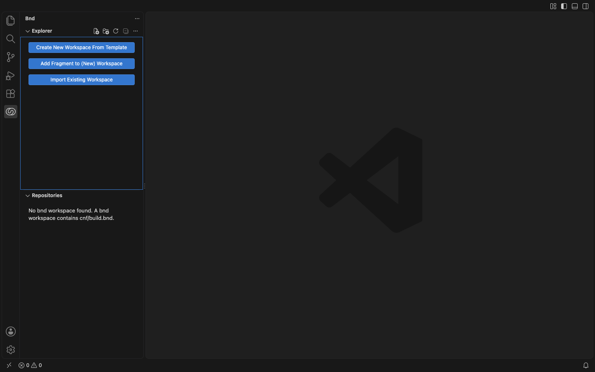
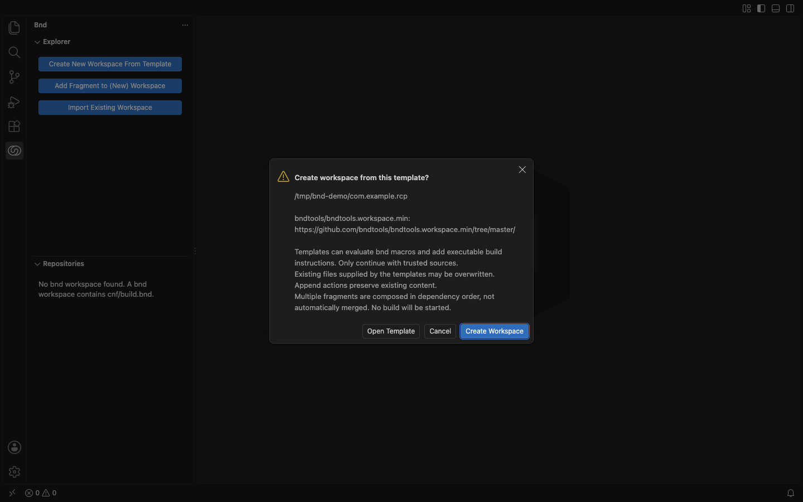
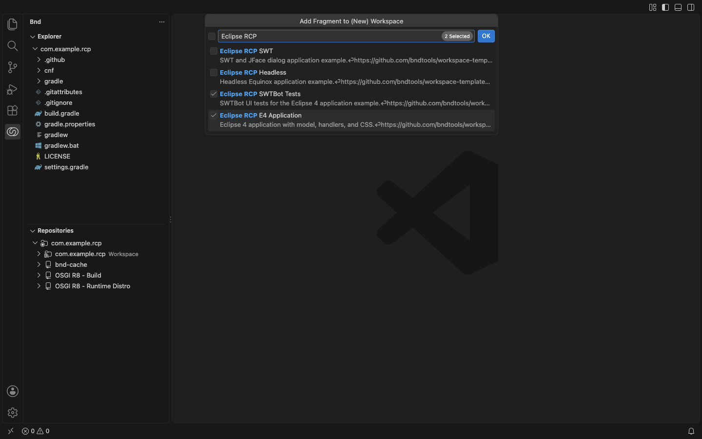
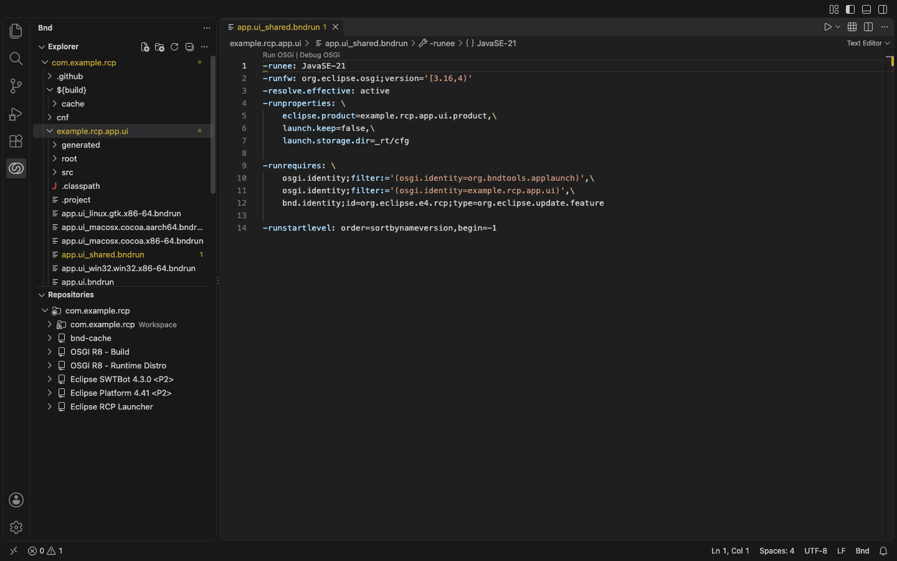

# Create a Workspace from Templates

Open an empty folder and select the **bnd** icon in the Activity Bar. Without a `cnf/build.bnd`, the bnd Explorer shows three actions:

- **Create New Workspace From Template** – generates a complete bnd workspace from one template (default: the minimal bndtools workspace).
- **Add Fragment to (New) Workspace** – adds one or more fragments from the upstream catalog, for example OSGi R8, JUnit 5 testing, Maven layout, or Eclipse RCP examples.
- **Import Existing Workspace** – opens or adds a folder that already contains `cnf/build.bnd`.

## Requirements

- A trusted window and the Java bnd language server (`bnd.server.mode: java`).
- Network access to the template sources configured in `bnd.wizard.workspaceTemplateIndexes` and `bnd.wizard.fragmentTemplateIndexes`.

## Example: Eclipse RCP Application

1. **Create New Workspace From Template** → select the template → confirm **Create Workspace**.

   

2. **Add Fragment to (New) Workspace** → type `Eclipse RCP` → check **Eclipse RCP E4 Application** and **Eclipse RCP SWTBot Tests** → Enter. The required **Eclipse Platform** fragment is included automatically.

   

3. Confirm **Add Fragments**. The projects, `cnf/ext` repository definitions, and `.bndrun` files appear in the bnd Explorer; the Repositories view indexes the Eclipse P2 sites.

   

The confirmation dialogs list every source and warn that templates can evaluate bnd macros. Use **Open Template** to inspect a source first. Existing files supplied by a template are replaced; `append` actions keep existing content. No build is started.

Add your own sources with **bnd: Add Workspace Template URL...** (GitHub repository, ZIP, or `.bnd` catalog) and **bnd: Add Fragment Template URL...** (fragment `index.bnd`).
